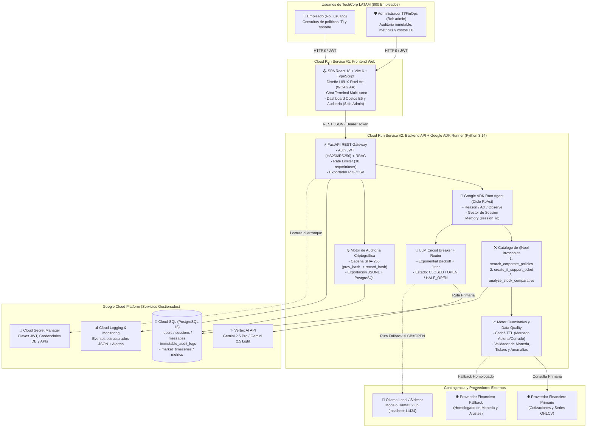
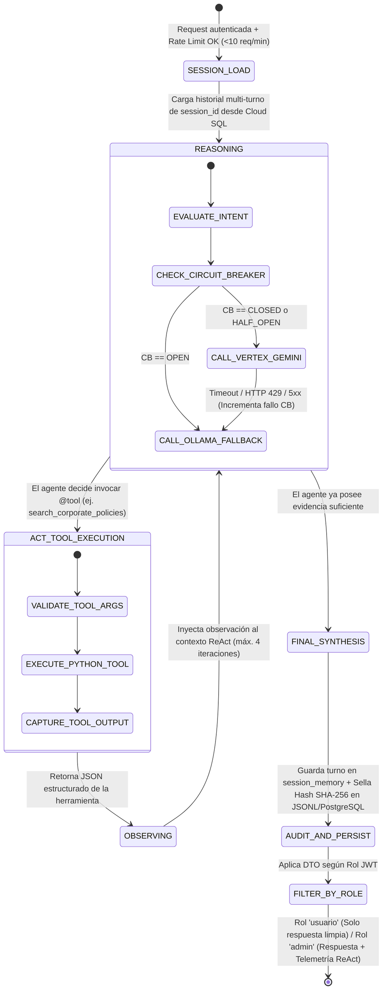
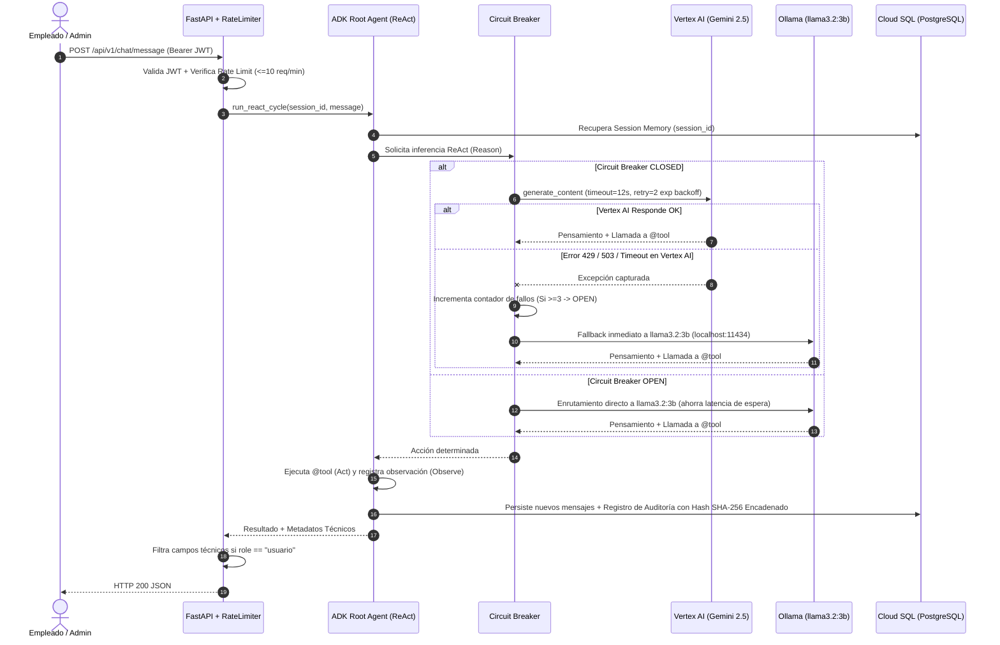

# E1 — Arquitectura del Sistema (`ARCHITECTURE.md`)
**Proyecto A — Asistente Empresarial Inteligente | Cliente: TechCorp LATAM (800 empleados)**  
**Modalidad 2.2:** Google Agent Development Kit (ADK) + Google Cloud Platform (Cloud Run, Cloud SQL, Vertex AI)

---

## 1. Visión Arquitectónica y Principios Rectorales

La arquitectura del **Asistente Empresarial Inteligente de TechCorp LATAM** fue diseñada por el equipo multidisciplinario siguiendo el principio de **Monolito Modular Cloud-Native Desacoplado** sobre **Google Cloud Run** y **Cloud SQL (PostgreSQL 16)**, evitando la sobreingeniería (sin Kubernetes/GKE, sin Kafka y sin mallas de microservicios innecesarias para una carga de 800 empleados), pero garantizando trazabilidad criptográfica, control estricto de costos, alta disponibilidad mediante un **Circuit Breaker con Fallback hacia Ollama (`llama3.2:3b`)** y seguridad por diseño (**RBAC estricto en backend**).

### Principios Aplicados
1. **Security by Design:** Autenticación JWT (HS256/RS256) validada en cada request; segregación total de esquemas de respuesta (Pydantic DTOs distintos para `user` y `admin` de modo que ningún dato de tokens, latencia, hash de auditoría o costos viaje jamás en el payload HTTP de un usuario estándar).
2. **Observability by Design:** Registro estructurado compatible con **Google Cloud Logging** (mínimo 6 tipos de eventos estructurados: `AGENT_REACT_STEP`, `LLM_INVOCATION`, `CIRCUIT_BREAKER_STATE_CHANGE`, `RATE_LIMIT_EXCEEDED`, `FINANCIAL_DATA_QUALITY_ALERT`, `AUDIT_RECORD_SEALED`).
3. **Resiliencia Multi-Proveedor (LLM y Datos Financieros):**
   - **LLM:** Vertex AI (`gemini-2.5-pro` / `gemini-2.5-flash`) como proveedor primario; si acumula 3 fallos consecutivos o timeouts (>12s), el **Circuit Breaker** pasa a estado `OPEN` y enruta automáticamente las consultas del ciclo ReAct hacia **Ollama (`llama3.2:3b`)** local/sidecar sin interrumpir la operación de los 800 empleados.
   - **Datos Bursátiles / Cuantitativos:** Proveedor primario con validación de frescura, moneda, cobertura de ticker y detección de anomalías por Z-score ($|z| > 3.5$), con fallback automático a proveedor secundario homologado sin mezclar monedas ni ajustes de forma silenciosa.

---

## 2. Diagrama de Arquitectura C4 — Nivel 1 (Contexto) y Nivel 2 (Contenedores)



---

## 3. Diagrama de Componentes Internos del Backend (C4 Nivel 3)

```mermaid
classDiagram
    class FastAPIGateway {
        +POST /api/v1/auth/login
        +POST /api/v1/chat/message
        +GET /api/v1/chat/sessions/{session_id}
        +GET /api/v1/admin/dashboard
        +GET /api/v1/admin/audit
        +GET /api/v1/admin/export/csv
        +GET /api/v1/admin/export/pdf
        +GET /health/live
        +GET /health/ready
        +GET /health/db
    }

    class SecurityMiddleware {
        +verify_jwt_token(token: str) UserClaims
        +require_role(allowed_roles: list[Role])
        +check_rate_limit(user_id: str) RateLimitStatus
    }

    class TechCorpADKRootAgent {
        +session_memory: SessionMemoryStore
        +tools: dict[str, ToolDefinition]
        +run_react_cycle(user_id: str, session_id: str, prompt: str) AgentExecutionResult
    }

    class LLMCircuitBreaker {
        +state: CircuitState
        +failure_count: int
        +invoke_with_fallback(messages, tools) LLMResponse
        +record_success()
        +record_failure(reason: str)
    }

    class QuantitativeMarketService {
        +get_verified_quote(ticker: str, expected_currency: str) MarketSeries
        +compute_indicators(series: MarketSeries) QuantIndicators
        +validate_data_quality(points: list) QualityReport
    }

    class ImmutableAuditService {
        +append_event(event: AuditPayload) AuditRecord
        +verify_chain_integrity() ChainVerificationResult
        +export_csv() bytes
        +export_pdf() bytes
    }

    FastAPIGateway --> SecurityMiddleware
    FastAPIGateway --> TechCorpADKRootAgent
    FastAPIGateway --> ImmutableAuditService
    TechCorpADKRootAgent --> LLMCircuitBreaker
    TechCorpADKRootAgent --> QuantitativeMarketService
```

---

## 4. Diagrama de Estados y Transiciones del Agente ReAct (Google ADK)

El ciclo **ReAct (`Reason` → `Act` → `Observe`)** implementado sobre Google ADK mantiene estado determinista y trazabilidad por cada turno de conversación asociado a `session_id`:



---

## 5. Flujo de Resiliencia del Circuit Breaker y Proveedores Financieros


